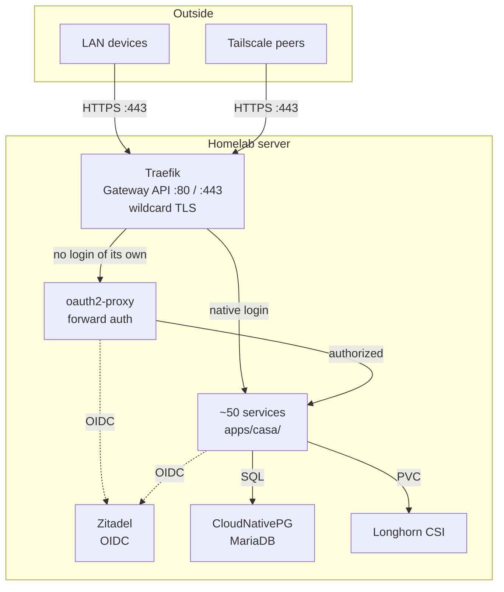

# Homelab

A home server run with production DevOps and SRE practices: **around fifty services in a Kubernetes cluster**.

This is not a demo stand but working infrastructure: it covers the daily needs of one household
while being engineered to the standards you would apply at work — digest-pinned images,
NetworkPolicies on the namespaces that run workloads, secrets that never touch Git, air-gapped CI,
blameless postmortems.

> Russian version: [`README.ru.md`](README.ru.md)

## What this demonstrates

| Area | What is here |
|---|---|
| **Kubernetes & GitOps** | k0s (embedded etcd, Calico vxlan), Longhorn CSI, CloudNativePG, MariaDB Operator, Traefik with Gateway API; Argo CD |
| **Supply chain & secrets** | Images pinned by `@sha256` digest, gitleaks on every push and PR, air-gapped runners with a checksum-verified toolchain; HashiCorp Vault and Vault Secrets Operator |
| **Observability & IaC** | All four signals — metrics, logs, traces, profiles — with cross-signal correlation; Terraform, one root module per external resource, Ansible with a `production` lint profile |
| **Testing & incidents** | CI gates; blameless postmortems with timelines, impact assessment, and tracked follow-ups |

## Architecture

One node: Ryzen 7 6800H, 8C/16T, Radeon 680M iGPU, 32 GiB RAM (≈27 GiB usable), 512 GB NVMe.

Solid arrows are the request path, dashed ones are OIDC calls. Everything else — Argo CD syncing
`clusters/casa/argocd/`, cert-manager issuing the wildcard through ACME DNS-01, the Vault Secrets Operator,
and the four observability signals — is described in the Platform, Supply chain and Observability
sections below.

## Platform

| Component | Role | Directory |
|---|---|---|
| k0s | Single-node Kubernetes: Calico CNI, etcd, CoreDNS | [`infra/casa/host/k0s/`](infra/casa/host/k0s/) |
| Traefik | Gateway API | [`platform/casa/traefik/`](platform/casa/traefik/) |
| Technitium DNS | Local DNS, wildcard zone, ad blocking | [`apps/casa/technitium/`](apps/casa/technitium/) |
| cert-manager | TLS via ACME DNS-01 | [`platform/casa/cert-manager/`](platform/casa/cert-manager/) |
| Longhorn | CSI storage: snapshots, clones, RWX | [`platform/casa/longhorn/`](platform/casa/longhorn/) |
| CloudNativePG | PostgreSQL clusters | [`platform/casa/cnpg/`](platform/casa/cnpg/) |
| MariaDB Operator | MariaDB instances | [`platform/casa/mariadb-operator/`](platform/casa/mariadb-operator/) |
| Argo CD | GitOps controller | [`clusters/casa/argocd/bootstrap/`](clusters/casa/argocd/bootstrap/) |
| Vault Secrets Operator | Syncs Vault paths into Kubernetes Secrets | [`apps/casa/vault/`](apps/casa/vault/) |
| Ansible | Host packages and preparation | [`infra/casa/ansible/`](infra/casa/ansible/) |
| Terraform | Resources outside the cluster | [`infra/casa/terraform/`](infra/casa/terraform/) |

ACME DNS-01 is served by `cert-manager-webhook-dns01`, a webhook I wrote: neither DNS provider offers a working RFC2136. It ships as a Helm chart and releases both the image and the chart to an OCI registry on tag.

Zitadel is the primary OIDC provider. Services without native OIDC sit behind oauth2-proxy in forward-auth mode, so access control is enforced at the edge rather than per application.

## Supply chain

Every tool is fetched from an in-cluster mirror and verified against a pinned checksum.

- **RustFS** — S3-compatible artifact mirror
- **ATS** — Apache Traffic Server, HTTP caching proxy
- **Athens** — Go module proxy
- **Verdaccio** — npm registry
- **Zot** — OCI registry

## Observability

All four signals, collected and correlated so a single click moves between them.

| Signal | Stack | Notes |
|---|---|---|
| Metrics | VictoriaMetrics and vmagent | Dozens of scrape jobs, sub-minute interval, weeks of retention |
| Logs | Grafana Alloy to Loki | Secret redaction; level, trace_id, span_id as structured metadata |
| Traces | Tempo via OTLP | Traefik sampling plus Beyla eBPF, cluster-wide |
| Profiles | Pyroscope via Alloy eBPF | Includes off-CPU profiling |
| Errors | GlitchTip | Sentry SDK |
| Uptime | Gatus declarative, Uptime Kuma via Terraform | External DNS and upstream checks |

Retention is set by capacity, not aspiration: metrics keep about a month, logs, traces and profiles
about a week. Grafana wires the cross-signal links (`tracesToLogsV2`, `derivedFields`,
`tracesToProfiles`), alerting is Unified Alerting delivered to ntfy, and dashboards live in Git as
JSON with UI edits disabled.

Worth reading: [`docs/research/observability-standards-and-approaches.md`](docs/research/observability-standards-and-approaches.md)
and [`docs/research/observability-pitfalls.md`](docs/research/observability-pitfalls.md).

## CI

The same set of gates runs on two sites.

`.forgejo/workflows/` is executed by a Forgejo Runner inside the cluster, where
every tool comes from an in-cluster mirror and is verified against a pinned checksum.

| Check | Tool | Scope |
|---|---|---|
| `meta / commitlint` | commitlint | Conventional Commits, header length cap, Latin-only header |
| `meta / actionlint` | actionlint | The workflows themselves |
| `meta / status` | status-badges.sh | Badge numbers match the repository |
| `security / gitleaks` | gitleaks | Secrets in commits and PR diffs |
| `lint / shellcheck` | shellcheck | All shell scripts |
| `lint / ansible-lint` | ansible-lint | `production` profile |
| `lint / tflint` | tflint | Terraform HCL, bundled ruleset |
| `lint / terraform-fmt` | terraform fmt | Canonical formatting of all root modules |
| `manifests / kubeconform` | kubeconform | Manifests against Kubernetes and CR schemas |
| `manifests / kube-linter` | kube-linter | Security checks, explicit allow-list |

`main` is mirrored to a public GitHub repository, and `.github/workflows/` runs the
same gates on GitHub-hosted runners. The runner image is `ubuntu-24.04`, matching the
`act-24.04` image the cluster runner uses; the gate set, the tool versions and the
sha256 pins are the same. What differs is where the toolchain comes from: in-cluster
mirror addresses do not resolve from outside, so the binaries are fetched from the
upstream GitHub releases while the pin still comes from
`apps/casa/rustfs/manifests/artifacts.tsv`. That makes the mirror a second,
independent execution of the gates rather than a copy of the first one.

One engine difference remains — Forgejo cancels a superseded run of the same workflow,
GitHub cancels only when `concurrency` is set
([details and sources](apps/casa/forgejo/README.md)). No GitHub workflow sets
it, so a run started by an earlier push to `main` is never cancelled — the same
behaviour the two Forgejo gates (`040-commitlint`, `080-secrets`) ask for explicitly.

Workflows are paired by file name: `.forgejo/workflows/030-kubeconform.yml` and
`.github/workflows/030-kubeconform.yml` are one check running on two engines. The
number in the name orders jobs in the Forgejo queue, where the runner has a fixed
number of slots; on GitHub jobs run in parallel and the number is kept for the pairing.

Local hooks run the same checks before a commit leaves the machine
([`.githooks/`](.githooks/)), so CI failures should be the exception rather than the routine.

## Services

### Infrastructure

| Service | Purpose |
|---|---|
| [Zitadel](apps/casa/zitadel/) | Identity provider and SSO (primary) |
| [oauth2-proxy](apps/casa/oauth2-proxy/) | Forward auth for services without their own login |
| [Technitium](apps/casa/technitium/) | DNS server and ad blocking |
| [Homepage](apps/casa/homepage/) | Start page |
| [Forgejo](apps/casa/forgejo/) | Private Git forge and CI |
| [Vault](apps/casa/vault/) | Secrets, transit, PKI |
| [Infisical](apps/casa/infisical/) | Self-hosted secrets manager |
| [RustFS](apps/casa/rustfs/) | S3-compatible object storage |
| [postgres](apps/casa/postgres/) | pgweb admin UI |
| [WUD](apps/casa/image-updates/) | Image update watcher, observe-only |
| [3x-ui](apps/casa/3x-ui/) | Personal Xray proxy management |
| [code-server](apps/casa/code-server/) | VS Code in the browser |
| [Headlamp](platform/casa/headlamp/), [Radar](platform/casa/radar/) | Cluster UIs |

### Applications

| Service | Purpose |
|---|---|
| [Immich](apps/casa/immich/) | Photo and video library |
| [Jellyfin](apps/casa/jellyfin/) | Home media server |
| [Navidrome](apps/casa/navidrome/) | Music library |
| [Nextcloud](apps/casa/nextcloud/) | Files, sync, calendar, contacts |
| [Seafile](apps/casa/seafile/) | File sync and sharing, with OnlyOffice |
| [Filestash](apps/casa/filestash/) | Web UI over the SMB share, files as they are |
| [OpenList](apps/casa/openlist/) | Web file list over the SMB share |
| [Jitsi](apps/casa/jitsi/) | Private video conferencing |
| [Element](apps/casa/element/) | Matrix chat and video calls via LiveKit — [custom Helm chart](apps/casa/element/chart/) |
| [Talk HPB](apps/casa/talk-hpb/) | Nextcloud Talk signaling |
| [Mailserver](apps/casa/mailserver/) | Stalwart mail and Bulwark webmail |
| [Paperless](apps/casa/paperless/), [PDF](apps/casa/pdf/) | Documents, OCR, PDF operations |
| [Home Assistant](apps/casa/home-assistant/) | Home automation |
| [Dawarich](apps/casa/dawarich/) | Location history |
| [Lute](apps/casa/lute/) | Language learning through reading |
| [Sure](apps/casa/sure/) | Personal finances |
| [Open WebUI](apps/casa/open-webui/), [LocalAI](apps/casa/local-ai/) | LLM chat interface and CPU inference |
| [Mermaid](apps/casa/mermaid-live-editor/) | Diagram editor |
| [Structurizr](apps/casa/structurizr/) | Architecture diagrams |

## Known limitations

- **Single node.** No HA, no second scheduler, no real quorum. There are no PodDisruptionBudgets or
  topology spread constraints because they would be theatre. This is also why environments are not
  split by namespace — see [`docs/adr/0001-namespace-ownership.md`](docs/adr/0001-namespace-ownership.md).
- **No automated restore drill.** Longhorn snapshot classes exist and backup is documented, but no
  backup target is configured and no restore has been rehearsed.
- **No SLOs.** Alerting is symptom-based rather than driven by error budgets.
- **No policy admission controller.** The NetworkPolicies are hand-written; nothing prevents a
  future manifest from shipping without one.
- **Terraform state is local**, with no lock and no drift detection.
- **Images are digest-pinned but unsigned.** No SBOM, no signature verification, no CVE gate.
