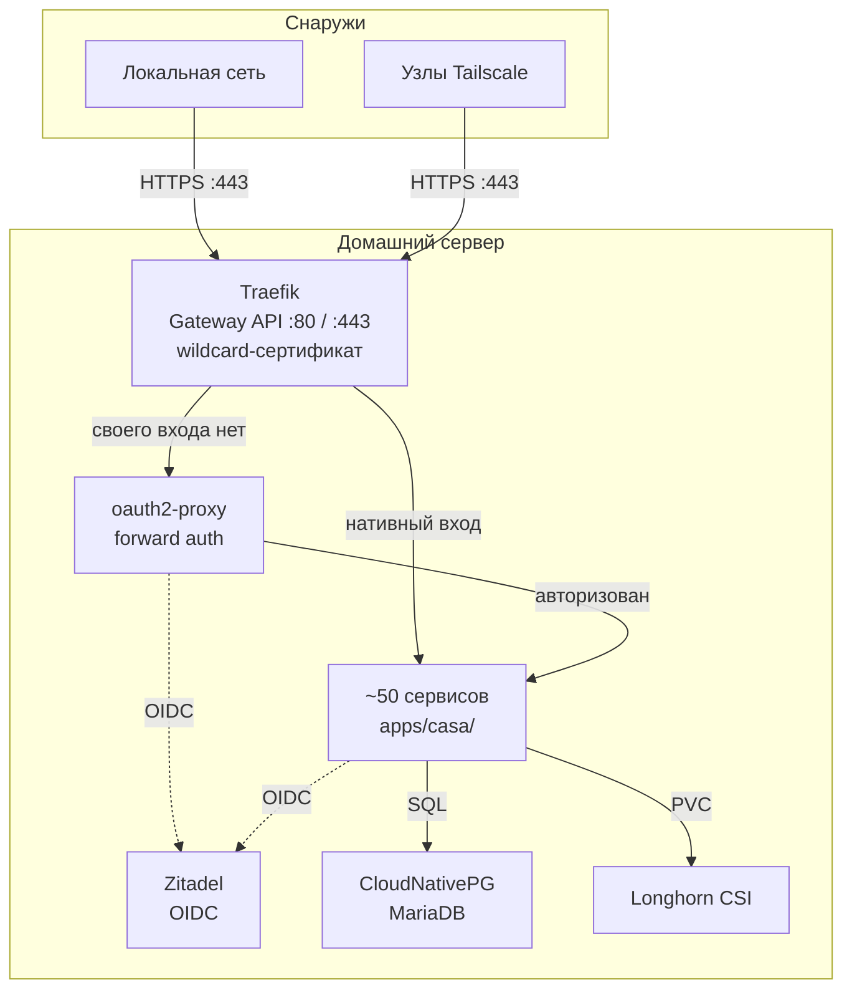

# Домашний сервер

Домашний сервер, работающий по production-практикам DevOps и SRE: **около пятидесяти сервисов в кластере Kubernetes**.

Здесь не демо-стенд, а работающая инфраструктура: она закрывает ежедневные потребности
домашнего хозяйства и при этом сделана по стандартам, которые применяют в работе, —
образы закреплены по digest, на namespace'ах с нагрузкой есть NetworkPolicy, секреты не
попадают в Git, CI работает без доступа в интернет, инциденты разбираются по blameless-постмортемам.

> English version: [`README.md`](README.md)

## Что здесь демонстрируется

| Область | Что здесь есть |
|---|---|
| **Kubernetes и GitOps** | k0s (встроенный etcd, Calico vxlan), Longhorn CSI, CloudNativePG, MariaDB Operator, Traefik с Gateway API; Argo CD |
| **Supply chain и секреты** | Образы закреплены по `@sha256`, gitleaks на каждом push и PR, раннеры без интернета с проверяемым по контрольным суммам тулчейном; HashiCorp Vault и Vault Secrets Operator |
| **Наблюдаемость и IaC** | Все четыре сигнала — метрики, логи, трейсы, профили — со связью друг с другом; Terraform, по одному root-модулю на внешний ресурс, Ansible с профилем линтера `production` |
| **Тестирование и инциденты** | Проверки в CI; blameless-постмортемы с таймлайном, оценкой влияния и отслеживаемыми действиями |

## Архитектура

Один узел: Ryzen 7 6800H, 8C/16T, iGPU Radeon 680M, 32 GiB (≈27 GiB доступно), 512 GB NVMe.

Сплошные стрелки — путь запроса, пунктирные — вызовы OIDC. Всё остальное — Argo CD,
синхронизирующий `clusters/casa/argocd/`, cert-manager с wildcard через ACME DNS-01, Vault Secrets
Operator и четыре сигнала наблюдаемости — описано в разделах «Платформа», «Supply chain» и
«Наблюдаемость» ниже.

## Платформа

| Компонент | Роль | Каталог |
|---|---|---|
| k0s | Одноузловой Kubernetes: Calico CNI, etcd, CoreDNS | [`infra/casa/host/k0s/`](infra/casa/host/k0s/) |
| Traefik | Gateway API | [`platform/casa/traefik/`](platform/casa/traefik/) |
| Technitium DNS | Локальный DNS, wildcard-зона, блокировка рекламы | [`apps/casa/technitium/`](apps/casa/technitium/) |
| cert-manager | TLS через ACME DNS-01 | [`platform/casa/cert-manager/`](platform/casa/cert-manager/) |
| Longhorn | CSI-хранилище: снапшоты, клоны, RWX | [`platform/casa/longhorn/`](platform/casa/longhorn/) |
| CloudNativePG | Кластеры баз PostgreSQL | [`platform/casa/cnpg/`](platform/casa/cnpg/) |
| MariaDB Operator | Инстансы MariaDB | [`platform/casa/mariadb-operator/`](platform/casa/mariadb-operator/) |
| Argo CD | GitOps-контроллер | [`clusters/casa/argocd/bootstrap/`](clusters/casa/argocd/bootstrap/) |
| Vault Secrets Operator | Синхронизирует пути Vault в Kubernetes Secrets | [`apps/casa/vault/`](apps/casa/vault/) |
| Ansible | Пакеты и подготовка хоста | [`infra/casa/ansible/`](infra/casa/ansible/) |
| Terraform | Ресурсы вне кластера | [`infra/casa/terraform/`](infra/casa/terraform/) |

ACME DNS-01 обслуживает `cert-manager-webhook-dns01` — написанный мной вебхук: ни у одного DNS-провайдера нет рабочего RFC2136. Поставляется как Helm-чарт; по тегу публикует и образ, и чарт в OCI-реестр.

Zitadel — основной OIDC-провайдер. Сервисы без нативного OIDC стоят за oauth2-proxy в режиме forward auth, поэтому контроль доступа обеспечивается на периметре, а не в каждом приложении.

## Supply chain

Каждый инструмент скачивается из внутрикластерного зеркала и сверяется с закреплённой контрольной суммой.

- **RustFS** — S3-совместимое зеркало артефактов
- **ATS** — Apache Traffic Server, HTTP-кэширующий прокси
- **Athens** — Go-прокси модулей
- **Verdaccio** — npm-реестр
- **Zot** — OCI-реестр

## Наблюдаемость

Все четыре сигнала собраны и связаны между собой так, что один клик переходит от одного к
другому.

| Сигнал | Стек | Детали |
|---|---|---|
| Метрики | VictoriaMetrics и vmagent | Десятки scrape-задач, интервал меньше минуты, несколько недель хранения |
| Логи | Grafana Alloy → Loki | Редакция секретов; level, trace_id, span_id как структурированные метаданные |
| Трейсы | Tempo через OTLP | Сэмплинг Traefik и eBPF Beyla по всему кластеру |
| Профили | Pyroscope через Alloy eBPF | Включая off-CPU профилирование |
| Ошибки | GlitchTip | Sentry SDK |
| Доступность | Gatus декларативно, Uptime Kuma через Terraform | Проверки внешнего DNS и апстримов |

Сроки хранения заданы ёмкостью, а не желанием: метрики примерно месяц, логи, трейсы и профили около недели. Grafana связывает сигналы (`tracesToLogsV2`, `derivedFields`, `tracesToProfiles`), алертинг — Grafana Unified Alerting с доставкой в ntfy, дашборды лежат в Git как JSON с отключённым редактированием в UI.

Стоит прочитать: [`docs/research/observability-standards-and-approaches.md`](docs/research/observability-standards-and-approaches.md)
и [`docs/research/observability-pitfalls.md`](docs/research/observability-pitfalls.md).

## CI

Один и тот же набор гейтов гоняется на двух площадках.

`.forgejo/workflows/` исполняет Forgejo Runner в кластере: каждый инструмент
приходит из внутрикластерного зеркала и сверяется с закреплённой контрольной суммой.

| Проверка | Инструмент | Что проверяет |
|---|---|---|
| `meta / commitlint` | commitlint | Conventional Commits, ограничение длины заголовка, только латиница |
| `meta / actionlint` | actionlint | Сами workflow |
| `meta / status` | status-badges.sh | Числа бейджей соответствуют репозиторию |
| `security / gitleaks` | gitleaks | Секреты в коммитах и диффах PR |
| `lint / shellcheck` | shellcheck | Все shell-скрипты |
| `lint / ansible-lint` | ansible-lint | Профиль `production` |
| `lint / tflint` | tflint | HCL Terraform, встроенный ruleset |
| `manifests / kubeconform` | kubeconform | Манифесты по схемам Kubernetes и CR |
| `manifests / kube-linter` | kube-linter | Проверки безопасности, явный allow-list |

`main` зеркалируется в публичный репозиторий GitHub, и `.github/workflows/` гоняет
те же гейты на GitHub-раннерах. Образ раннера — `ubuntu-24.04`, тот же, что
`act-24.04` у раннера в кластере; состав гейтов, версии инструментов и пины по
sha256 те же. Отличается источник тулчейна: адреса внутрикластерных зеркал вне
кластера не резолвятся, поэтому бинари берутся из апстрим-релизов GitHub, а пин
по-прежнему приходит из `apps/casa/rustfs/manifests/artifacts.tsv`. Так
зеркало становится второй, независимой площадкой, а не копией первой.

Одно расхождение в дефолтах движков остаётся — Forgejo отменяет предыдущий прогон
того же workflow, GitHub только при заданном `concurrency`
([подробности и ссылки на доку](apps/casa/forgejo/README.md)). Ни в одном
GitHub-workflow он не задан, поэтому прогон от предыдущего push в `main` не
отменяется: то же поведение, которого два гейта в Forgejo (`040-commitlint`,
`080-secrets`) требуют явно.

Workflow парные по именам файлов: `.forgejo/workflows/030-kubeconform.yml` и
`.github/workflows/030-kubeconform.yml` — одна проверка на двух движках. Номер в
имени задаёт порядок выдачи задач в очереди Forgejo, где у раннера фиксированное
число слотов; на GitHub джобы идут параллельно, а номер сохранён ради парности.

Локальные хуки прогоняют те же проверки до того, как коммит покинет машину
([`.githooks/`](.githooks/)), так что падения в CI — исключение, а не норма.

## Сервисы

### Инфраструктура

| Сервис | Назначение |
|---|---|
| [Zitadel](apps/casa/zitadel/) | Identity provider и SSO (основной) |
| [oauth2-proxy](apps/casa/oauth2-proxy/) | Forward auth для сервисов без своего входа |
| [Technitium](apps/casa/technitium/) | DNS-сервер и блокировка рекламы |
| [Homepage](apps/casa/homepage/) | Стартовая страница |
| [Forgejo](apps/casa/forgejo/) | Приватный Git-сервис и CI |
| [Vault](apps/casa/vault/) | Секреты, transit, PKI |
| [Infisical](apps/casa/infisical/) | Self-hosted secrets manager |
| [RustFS](apps/casa/rustfs/) | S3-совместимое объектное хранилище |
| [postgres](apps/casa/postgres/) | Веб-админка PostgreSQL (pgweb) |
| [WUD](apps/casa/image-updates/) | Наблюдение за обновлениями образов |
| [3x-ui](apps/casa/3x-ui/) | Управление личным Xray-прокси |
| [code-server](apps/casa/code-server/) | VS Code в браузере |
| [Headlamp](platform/casa/headlamp/), [Radar](platform/casa/radar/) | UI кластера |

### Приложения

| Сервис | Назначение |
|---|---|
| [Immich](apps/casa/immich/) | Фото- и видеотека |
| [Jellyfin](apps/casa/jellyfin/) | Домашний медиасервер |
| [Navidrome](apps/casa/navidrome/) | Музыкальная библиотека |
| [Nextcloud](apps/casa/nextcloud/) | Файлы, синхронизация, календарь, контакты |
| [Seafile](apps/casa/seafile/) | Файловая синхронизация и обмен файлами, с OnlyOffice |
| [Filestash](apps/casa/filestash/) | Веб-интерфейс к SMB-шаре, файлы «как есть» |
| [OpenList](apps/casa/openlist/) | Веб-список файлов на SMB-шаре |
| [Jitsi](apps/casa/jitsi/) | Приватные видеоконференции |
| [Element](apps/casa/element/) | Matrix-чат и видеозвонки через LiveKit — [собственный Helm-чарт](apps/casa/element/chart/) |
| [Talk HPB](apps/casa/talk-hpb/) | Signaling для Nextcloud Talk |
| [Mailserver](apps/casa/mailserver/) | Почта Stalwart и веб-почта Bulwark |
| [Paperless](apps/casa/paperless/), [PDF](apps/casa/pdf/) | Документы, OCR, операции с PDF |
| [Home Assistant](apps/casa/home-assistant/) | Автоматизация дома |
| [Dawarich](apps/casa/dawarich/) | История местоположений |
| [Lute](apps/casa/lute/) | Изучение языков через чтение |
| [Sure](apps/casa/sure/) | Личные финансы |
| [Open WebUI](apps/casa/open-webui/), [LocalAI](apps/casa/local-ai/) | Чат-интерфейс для LLM и CPU-инференс |
| [Mermaid](apps/casa/mermaid-live-editor/) | Редактор диаграмм |
| [Structurizr](apps/casa/structurizr/) | Архитектурные диаграммы |

## Известные ограничения

- **Один узел.** Ни HA, ни второго планировщика, ни настоящего кворума. PodDisruptionBudget и
  topology spread constraints не используются, потому что на одном узле они были бы
  театром. По этой же причине среды не разводятся namespace'ами — см.
  [`docs/adr/0001-namespace-ownership.md`](docs/adr/0001-namespace-ownership.md).
- **Нет автоматической проверки восстановления.** VolumeSnapshotClasses у Longhorn есть, бэкап
  описан, но backup target не настроен и восстановление ни разу не репетировали.
- **Нет SLO.** Алертинг симптомный, а не построенный на error budgets.
- **Нет admission-контроллера политик.** NetworkPolicy написаны руками, и ничто не мешает
  выпустить манифест без него.
- **State Terraform локальный** — без лока и без обнаружения дрейфа.
- **Образы закреплены по digest, но не подписаны.** Ни SBOM, ни проверки подписи, ни фильтра по CVE.
